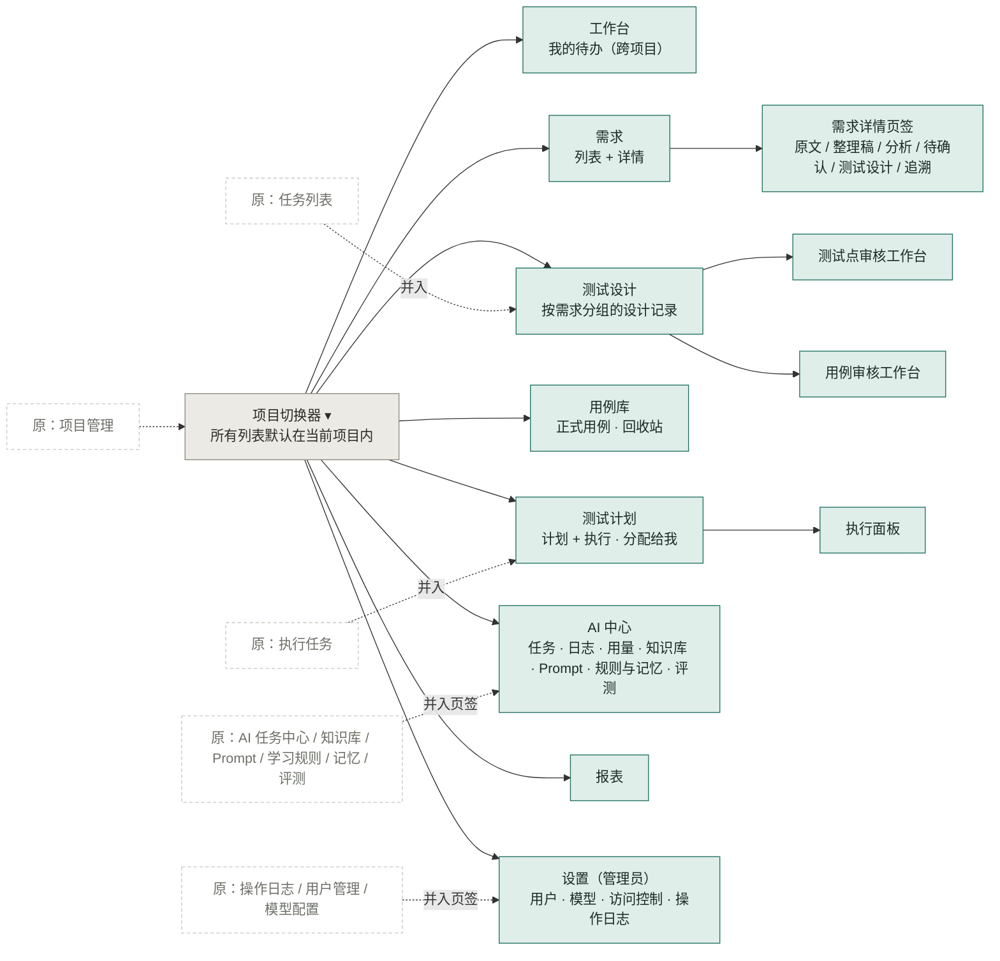
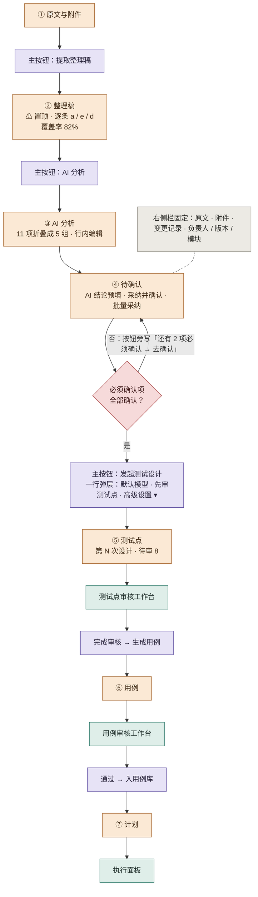
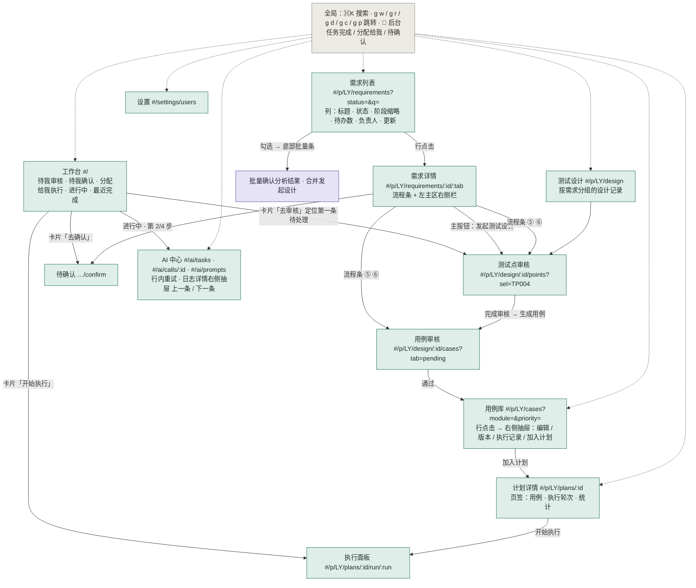
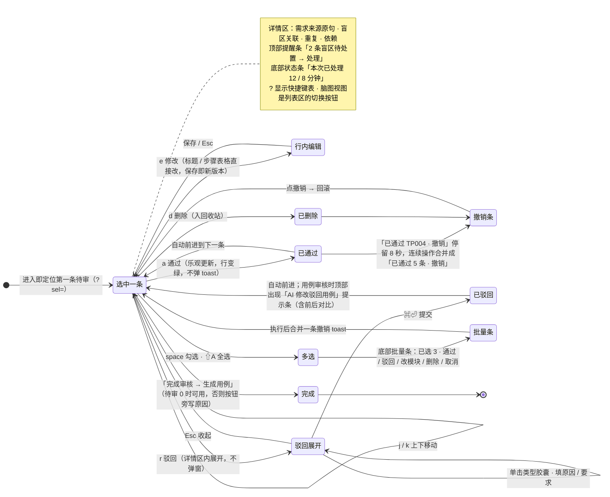
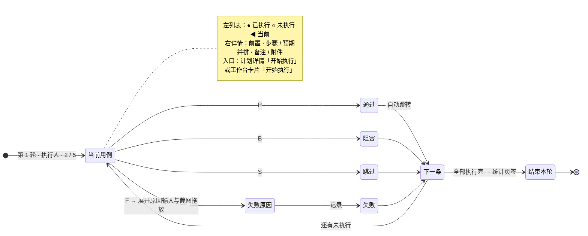
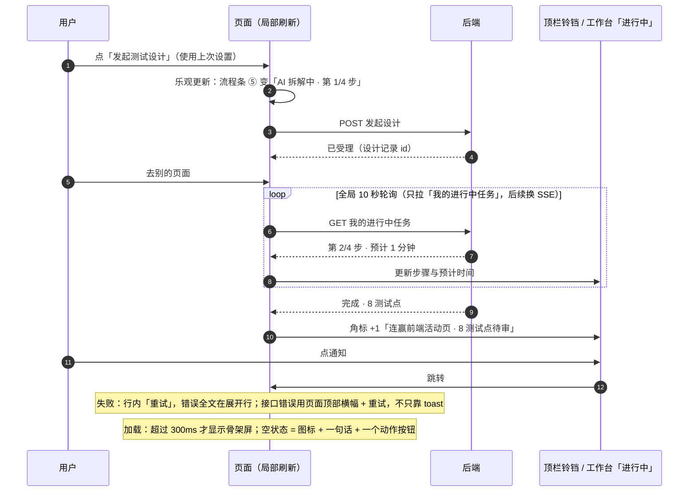

# 天工前端交互图（v2.2 提案）

对应 `docs/前端交互设计方案_v2.2.md`（2026-10-16）。同目录 `前端交互图_v2.2.html` 是可直接打开的版本（含路由表、按钮层级与原型截图），`前端交互图_v2.2.png` 是整页渲染。可点击原型：`docs/design/前端交互原型_v2.2.html`。

## 1. 信息架构 （15 个平级菜单收成 8 项，项目是一级上下文）

## 2. 需求主线与流程条 （一条需求从原文到执行，每步一个主按钮）

## 3. 页面跳转与路由 （哈希路由，筛选 / 页签 / 选中项都进 URL，刷新与后退成立）

## 4. 审核工作台交互 （测试点与用例审核共用一套壳：左列表右详情，键盘驱动，撤销优于确认）

## 5. 执行面板交互 （逐条执行，结果按钮带快捷键，失败就地记录）

## 6. 反馈与后台任务 （乐观更新、全局轮询、铃铛通知）

## 7. 路由表

| 页面 | URL |
|---|---|
| 工作台 | `#/` |
| 需求列表 | `#/p/LY/requirements?status=designing&q=连赢` |
| 需求详情某页签 | `#/p/LY/requirements/67cc1c74/analysis` |
| 测试点审核，定位到某条 | `#/p/LY/design/97571bd28eac/points?sel=TP004` |
| 用例审核 | `#/p/LY/design/bdbaabc721b1/cases?tab=pending` |
| 用例库 | `#/p/LY/cases?module=活动配置&priority=P0` |
| 计划详情 / 执行面板 | `#/p/LY/plans/3518fc5a` · `#/p/LY/plans/3518fc5a/run/c23c115e` |
| AI 中心 | `#/ai/tasks` · `#/ai/calls/<id>` · `#/ai/prompts` |
| 设置 | `#/settings/users` |

## 8. 快捷键

全局：`⌘K` 搜索，`g w / g r / g d / g c / g p` 跳转工作台 / 需求 / 测试设计 / 用例库 / 计划，`?` 快捷键表。
工作台（审核 / 执行）：`j k` 移动，`a r e d` 通过 / 驳回 / 修改 / 删除，`space` 勾选，`⇧A` 全选，`⌘⏎` 提交表单，`Esc` 收起；执行面板 `P F B S` 通过 / 失败 / 阻塞 / 跳过。
