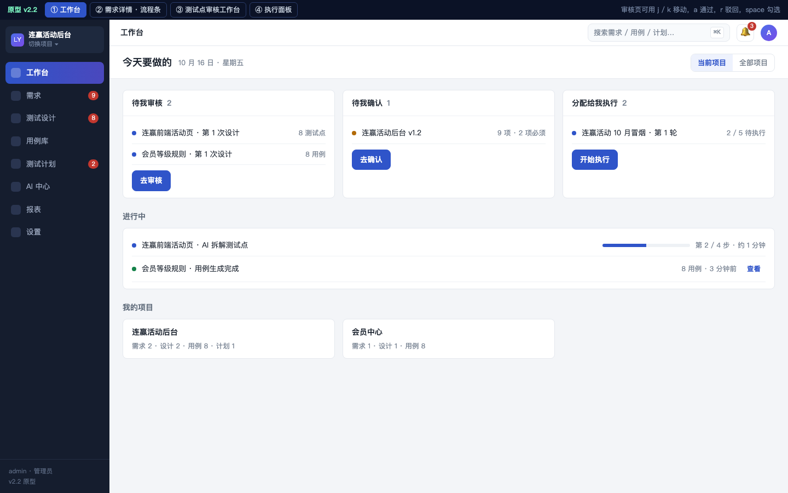
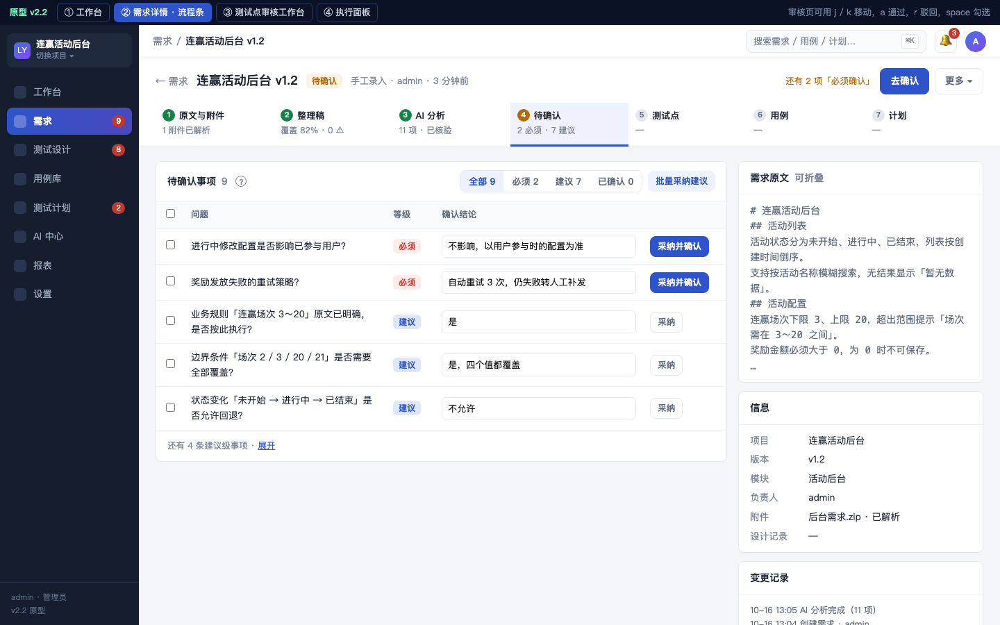
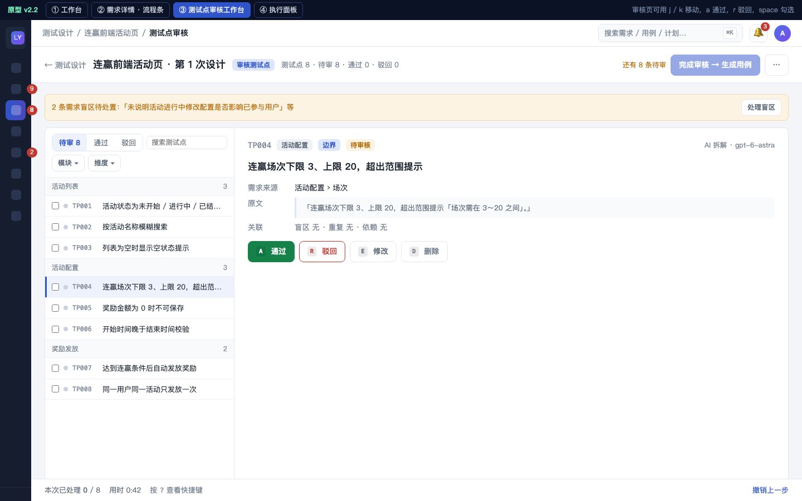
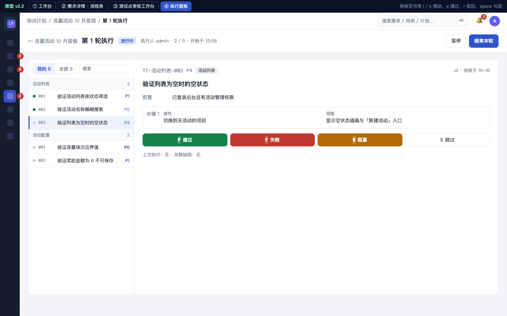

# 天工前端交互设计方案（v2.2 提案）

- 日期：2026-10-16
- 对象：`app/web/index.html`（当前 v2.1.4，单文件 7,762 行）
- 性质：设计提案，不含代码改动；配套可点击原型 `docs/design/前端交互原型_v2.2.html`
- 诊断依据：在独立沙箱（SQLite + 桩模型，不碰生产库）灌入演示数据后逐页走查，并对源码做了结构统计

## 0. 结论

现在的前端把平台按「实体」切成了 15 个平级菜单（需求、任务、用例、计划、AI 任务……），而用户真正的工作是一条线：**需求 → 整理稿 → 分析 → 待确认 → 测试点审核 → 用例审核 → 计划 → 执行**。线上的每一步都要在不同菜单之间来回跳，没有 URL，刷新就回工作台，审核几十条内容全靠逐行点小图标，页面上靠大段灰色说明文字告诉人下一步该去哪。这是体验差的根子，不是某一页的样式问题。

方案分四件事：

1. **按工作流重组信息架构**：项目成为一级上下文，主线流程在需求详情里用一条「流程条」串起来，任务不再是独立实体，而是需求的「测试设计」阶段。
2. **把三个审核页做成审核工作台**：左列表右详情，键盘逐条处理，批量操作常驻，动作有标签、有撤销。
3. **补齐基础交互契约**：URL 路由与刷新保持、局部刷新、加载骨架、空状态、错误状态、撤销式确认、统一的按钮层级与行操作规范，提示文字从页面正文移到「?」气泡。
4. **技术上渐进替换**：新壳 + 路由先上，再按页面迁到 Vue 3（本地 vendor，无构建），旧页面在迁完前继续可用。

建议分 5 期、约 8 周完成；第 0 期（1 周）只做止血，不动架构，立竿见影。

## 1. 现状诊断

### 1.1 走查发现的问题（按严重度）

| # | 问题 | 证据 | 影响 |
|---|---|---|---|
| 1 | **没有 URL**：所有页面都是同一个地址，刷新回到工作台，浏览器后退无效，链接不能发给同事 | 源码无 `location.hash` / `pushState`；`switchView` 只切 `display` | 审核到一半刷新即丢位置；无法在群里贴「这条需求」 |
| 2 | **主线流程被拆散在 4 个菜单组里** | 需求在「需求中心」，拆解与用例审核在「测试点 · 用例库 › 任务列表」，AI 进度在「AI 中心 › AI 任务中心」，执行在「测试计划 · 执行」；同一个任务在 3 个列表里出现 | 用户要记住「下一步去哪个菜单」；工作台的待办卡片只是把这些列表再抄一遍 |
| 3 | **审核靠逐行点小图标** | 用例审核行尾 7 个 14px 灰图标（✓ ⧉ ⏱ ✎ × 🗑 🔒）无文字；测试点审核同样；盲区每行 4 个按钮 × N 行 | 审 50 条用例至少 50 次精确点击 + 50 个 toast；无键盘；误点删除与通过只差 20px |
| 4 | **页签套页签套筛选**：任务 › 测试点审核 › 测试点 › 模块 / 状态 / 维度 / 搜索 / 只导已通过 | 四层导航 + 一行 10 个「维度」胶囊 + 两个下拉 + 搜索框 + 4 个按钮同屏 | 第一次进来不知道从哪开始；默认落在「需求盲区」而不是测试点 |
| 5 | **靠说明文字兜底** | `class="hint"` 539 处；需求列表标题旁挤着 3 行小字说明；测试点审核顶部两行处置规则 | 文字 11～12px、浅灰（`#8b95a5` 在白底对比度约 3:1），没人读，又占掉首屏 |
| 6 | **每次操作整块重绘** | `innerHTML =` 136 处；`keepScroll` 10 处专门修滚动跳动；内联 `onclick` 520 处 | 点一个「通过」整页闪一下、焦点丢失、展开状态复位 |
| 7 | **后台进度靠轮询，且只在当前页** | `setTimeout` 2～4 秒轮询 5 处；离开页面就不再提示 | 发起设计后去别的页，完成了没人知道 |
| 8 | **阻塞型流程没有给出口** | 分析后自动产出 8 条「必须确认」事项，每条都要人工填确认结论；「开始测试设计」按钮灰掉但不说为什么，「去确认 →」是一行 12px 的链接 | 新用户卡在第一条需求上 |
| 9 | **高级参数前置** | 新建任务抽屉一上来要选生成模型、评审模型、模板、项目、两个勾选 | 日常用户 95% 用默认值，却每次面对 6 个控件 |
| 10 | **危险操作与主操作并排** | 需求详情头部：编辑 · 合并到 · 归档 · **删除（红）** · 开始测试设计；任务头部「删除任务」红按钮常驻 | 误触成本高，且红色削弱了真正的主按钮 |
| 11 | **表格承载长文本** | 用例库表 14 列，步骤与预期结果在单元格里折行；1440 宽下操作列被挤到最右 | 读不完整、横向滚动 |
| 12 | **任务用哈希 ID 标识** | 面包屑「任务 97571bd28eac」，工作台里「用例 8 连赢前端活动页」 | 用户记不住 ID，要靠需求名反查 |
| 13 | **反馈只有 toast** | `toast(` 363 处，3.8 秒后消失，无撤销；删除走确认弹窗 51 处 | 误操作不可逆；连续操作时 toast 堆叠 |
| 14 | **空状态与加载态缺失** | 「还没有整理稿」「加载中…」纯文本 | 不知道下一步能做什么 |
| 15 | **细节瑕疵** | 侧栏偶发两项同时高亮；当前项目选择器默认「全部项目」却是最重要的上下文；39 个 `<dialog>` 风格不一 | 累积成「粗糙」的整体印象 |

### 1.2 根因

- **信息架构按数据模型长出来**：后端每加一个实体（需求 / 任务 / 计划 / 盲区 / 重复对 / 评测 / 画像……）前端就加一个列表页或页签，没有按「谁、在什么时候、要完成什么」组织。
- **单文件全局状态 + 字符串拼模板**：没有组件边界，任何局部变化都只能整块重绘；交互细节（焦点、滚动、展开）只能打补丁。
- **文案替代设计**：流程不自明，就加一段灰字解释；灰字越多，页面越像说明书。

## 2. 设计目标与原则

| 目标 | 可量化的样子 |
|---|---|
| 一条需求从录入到用例通过，不离开需求详情 | 主线 7 步全部在同一页面的流程条上完成，跨菜单跳转 0 次 |
| 审核 50 条测试点 | 键盘流 ≤ 60 次按键、不出现弹窗；鼠标流每条 ≤ 1 次点击 |
| 任何页面可刷新、可后退、可分享 | 100% 页面有 URL；刷新后停在原页签 + 原筛选 |
| 首屏不读说明也能开始 | 每页只有 1 个主按钮；说明文字在正文里消失，移到「?」气泡 |
| 后台任务完成有感知 | 顶栏通知角标 + 可点击跳转，不依赖停留在当前页 |

原则：

1. **流程优先于实体**：导航按阶段排列，页面按「下一步」组织。
2. **一页一件事，一件事一个主按钮**：次要动作收进「更多」，危险动作永远在更多里且需二次确认或可撤销。
3. **列表 + 详情，不用弹窗审内容**：弹窗只用于短表单和不可逆确认。
4. **局部刷新，状态不丢**：行级更新、乐观更新、焦点和滚动不动。
5. **撤销优于确认**：可逆操作直接执行并给 8 秒撤销；不可逆操作才弹确认。
6. **默认值隐藏复杂度**：高级参数折叠，记住上次选择。

## 3. 信息架构

### 3.1 新导航

左栏从 15 项收成 8 项，顶部是项目切换器（项目是一级上下文，所有列表默认在当前项目内，「全部项目」只在工作台和报表可选）：

```
[项目切换器 ▾ 连赢活动后台]

工作台            ← 我的待办（跨项目）
需求              ← 需求列表 + 需求详情（整理稿 / 分析 / 待确认 / 测试设计 / 追溯 都在详情里）
测试设计          ← 原「任务列表」，按需求分组；测试点审核 / 用例审核工作台
用例库            ← 正式用例（含回收站）
测试计划          ← 计划 + 执行（「执行任务」并入，默认筛「分配给我」）
AI 中心           ← 任务进度 / 调用日志 / 用量 / Prompt / 规则 / 记忆（页内页签）
报表
设置（管理员）    ← 用户 / 模型 / 数据可见范围 / 两步验证 / 操作日志
```

- 「执行任务」「Prompt 管理」「学习规则」「记忆」「模型配置」「需求分析评测」「操作日志」「用户管理」从一级菜单移走，并入上面的页内页签。
- 侧栏可折叠成图标栏（56px），审核工作台默认折叠。
- 顶栏右侧：全局搜索（`⌘K` 唤起，结果分组）、通知铃铛（后台任务完成 / 分配给我 / 待确认）、头像菜单。

### 3.2 主线流程与流程条

需求详情顶部固定一条流程条，每步显示状态与数量，点哪步就切到哪步；当前应做的一步高亮，并带唯一的主按钮：

```
① 原文与附件 ✓   ② 整理稿 ✓ 82%   ③ AI 分析 ✓   ④ 待确认 2/9 ⚠   ⑤ 测试点 8 待审   ⑥ 用例 —   ⑦ 计划 —
                                                   ▲ 当前：确认 2 项「必须确认」事项后可开始测试设计   [批量确认]
```

- 「任务」概念对用户隐藏：一条需求发起一次设计就是一条「设计记录」，显示为「第 2 次设计 · 2026-10-16 · 8 用例」，不再出现哈希 ID；多需求合并设计显示为「合并设计（3 条需求）」。
- 阻塞条件直接写在被禁用的主按钮旁，并给一键入口（例：「还有 2 项必须确认 → 去确认」按钮本身可点）。

### 3.3 URL 路由表

哈希路由，无需后端改动，刷新 / 后退 / 分享都成立：

| 页面 | URL |
|---|---|
| 工作台 | `#/` |
| 需求列表 | `#/p/LY/requirements?status=designing&q=连赢` |
| 需求详情某页签 | `#/p/LY/requirements/67cc1c74/analysis` |
| 测试点审核，定位到某条 | `#/p/LY/design/97571bd28eac/points?sel=TP004` |
| 用例审核 | `#/p/LY/design/bdbaabc721b1/cases?tab=pending` |
| 用例库 | `#/p/LY/cases?module=活动配置&priority=P0` |
| 计划详情 / 执行面板 | `#/p/LY/plans/3518fc5a` · `#/p/LY/plans/3518fc5a/run/c23c115e` |
| AI 中心 | `#/ai/tasks` · `#/ai/calls/<id>` · `#/ai/prompts` |
| 设置 | `#/settings/users` |

筛选、页签、分页、选中项都进 query，页面状态即 URL。

## 4. 全局框架

### 4.1 布局

```
┌──────────┬──────────────────────────────────────────────────────────────┐
│ 项目 ▾   │ 面包屑  需求 / 连赢活动后台 v1.2            ⌘K 搜索  🔔3  头像 │
│          ├──────────────────────────────────────────────────────────────┤
│ 工作台   │ 页头：标题 · 状态胶囊 · 元信息              [主按钮] [更多 ▾]  │
│ 需求  ●  │ 流程条（需求详情）/ 页签（其他页）                              │
│ 测试设计 ├──────────────────────────────────────────────────────────────┤
│ 用例库   │                                                              │
│ 测试计划 │ 内容区：通栏，最大宽 1600，不再居中留白                        │
│ AI 中心  │                                                              │
│ 报表     │                                                              │
│ 设置     │                                                              │
└──────────┴──────────────────────────────────────────────────────────────┘
```

- 页头固定（sticky），主按钮永远在右上同一位置。
- 「更多 ▾」收纳：编辑、合并、归档、导出、删除（删除在最底、红字、分隔线隔开）。
- 内容区通栏；表格页贴边；详情页左右分栏（内容 : 侧栏 = 7 : 3）。

### 4.2 密度与可读性

| 项 | 现在 | 建议 |
|---|---|---|
| 正文字号 | 13.5px，提示 11～12px | 正文 14px，次要 13px，最小 12px（仅标签） |
| 次要文字色 | `#8b95a5`（对比度约 3.0:1） | `#5f6b7a`（≥ 4.5:1） |
| 表格行高 | 自适应，长文本折行 | 固定 44px，单行省略，悬停 / 展开看全文 |
| 行操作 | 7 个灰图标 | 主动作 1～2 个文字按钮 + 「⋯」菜单；悬停才显示 |
| 卡片 | 多层卡片嵌套 | 页面级只有一层容器，内部用分割线 |
| 间距 | 不统一 | 8pt 栅格：4 / 8 / 12 / 16 / 24 / 32 |

## 5. 关键页面设计

### 5.1 工作台

目标：进来 3 秒内知道「我现在该做什么」。

```
今天要做的                                   [全部项目 ▾]
┌─ 待我审核 ──────────────────┐ ┌─ 待我确认 ─────────────┐ ┌─ 分配给我执行 ─────┐
│ 连赢前端活动页 · 8 测试点    │ │ 连赢活动后台 v1.2 · 9 项 │ │ 10 月冒烟 · 2 条   │
│ 会员等级规则 · 8 用例        │ │                          │ │                    │
│ [去审核]                     │ │ [去确认]                  │ │ [开始执行]          │
└──────────────────────────────┘ └──────────────────────────┘ └────────────────────┘
进行中                                                          最近完成
● 连赢前端活动页 · AI 拆解中 · 第 2/4 步 · 预计 1 分钟            ✓ 会员等级规则 · 8 用例 · 3 分钟前
```

- 卡片即待办，每张卡一个动作按钮，点击直达对应工作台并定位到第一条待处理项。
- 「我的项目」「最近操作」降级为页面底部的次要区块。

### 5.2 需求列表

- 默认当前项目；列：标题、状态、阶段（流程条缩略：`②③④● ⑤ ⑥`）、待办数（待确认 9 / 待审 8）、负责人、更新时间。
- 行点击进详情；行尾只留「发起设计」（可用时）和「⋯」。
- 筛选只保留状态与搜索，其余进「更多筛选」。
- 「批量确认分析结果」「合并发起测试设计」改为勾选后出现的底部批量条。

### 5.3 需求详情

布局：流程条 + 左主区右侧栏。

```
← 需求   连赢活动后台 v1.2   待确认                               [去确认 2 项]  [更多 ▾]
①原文 ✓  ②整理稿 ✓82%  ③分析 ✓  ④待确认 2/9 ●  ⑤测试点  ⑥用例  ⑦计划
┌──────────────────────────────────────────────┬────────────────────┐
│ ④ 待确认事项                                   │ 需求原文（可折叠）  │
│ [全部 9] [必须 2] [建议 7] [已确认 0]  [批量确认]│ 相关附件 2         │
│ ☐ 1 进行中修改配置是否影响已参与用户   必须 ·  │ 变更记录           │
│      结论 [___________________]  [确认] [采纳]  │ 负责人 / 版本 / 模块│
│ ☐ 2 ...                                         │                    │
└──────────────────────────────────────────────┴────────────────────┘
```

- 每一步的内容在主区切换，右侧栏固定显示原文与元信息，核对时不用来回切页签。
- 待确认事项：**AI 建议结论预填进输入框**（现在是空的），一键「采纳并确认」；同类事项可勾选后批量采纳。
- 分析结果页：左侧 11 个分析项改成可折叠分组（功能点 / 规则 / 流程 / 边界与状态 / 权限依赖风险），每条行内编辑，不弹窗。
- 整理稿页：按模块折叠，⚠ 条目置顶，逐条「通过 / 改 / 删」用键盘 `a / e / d`，与审核工作台一致。
- 头部主按钮随阶段变化：录入阶段「提取整理稿」→「AI 分析」→「去确认」→「发起测试设计」→「查看测试点」。

### 5.4 测试点审核工作台（核心）

主从布局，列表在左、详情在右，键盘驱动：

```
← 连赢前端活动页 · 第 1 次设计         测试点 8 · 待审 8 · 通过 0 · 驳回 0      [完成审核 → 生成用例]  [⋯]
┌ 筛选 ────────────────┬──────────────────────────────────────────────────────────┐
│ [待审 8] 通过 驳回    │ TP004  活动配置 · 边界                                    │
│ 模块 ▾  维度 ▾  搜索 │ 连赢场次下限 3、上限 20，超出范围提示                     │
├──────────────────────┤ 需求来源：活动配置 › 场次   「连赢场次下限 3、上限 20…」  │
│ ▸ 活动列表 3         │ ──────────────────────────────────────────────────────── │
│   TP001 活动状态…  ○ │ 盲区关联：无      重复：无      依赖：无                  │
│   TP002 按活动名…  ○ │                                                           │
│   TP003 列表为空…  ○ │ [A 通过]  [R 驳回]  [E 修改]  [D 删除]       ← 文字按钮  │
│ ▾ 活动配置 3         │                                                           │
│ ● TP004 连赢场次…  ○ │ 驳回（展开式，不弹窗）                                     │
│   TP005 奖励金额…  ○ │ 类型 [颗粒度过粗] [预期不可验证] [超出需求] …             │
│   TP006 开始时间…  ○ │ 原因 [__________________________]  要求 [____________]   │
│ ▸ 奖励发放 2         │                                        [确认驳回 ⏎]     │
└──────────────────────┴──────────────────────────────────────────────────────────┘
底部批量条（勾选后出现）：已选 3 · [通过] [驳回] [改模块] [删除]  [取消]
```

- 键盘：`j / k` 上下，`a` 通过并跳下一条，`r` 驳回（展开驳回区，`⌘⏎` 提交），`e` 修改，`space` 勾选，`?` 快捷键表。
- 通过后行变绿并自动前进，不弹 toast；底部状态条累计「本次已处理 12 / 8 分钟」。
- 驳回表单在详情区展开，不用弹窗；驳回类型做成胶囊单击。
- 「需求盲区」「疑似重复」不再是前置页签，而是详情区里的关联块，以及顶部的提醒条「2 条盲区待处置 → 处理」。
- 「查漏补缺」「重复检查」「AI 补充」「人工对比」「导出」收进「⋯」。
- 脑图视图保留，作为列表区的切换按钮。

### 5.5 用例审核工作台

与 5.4 同一套壳，详情区换成用例卡：

```
TC-活动配置-003   P1 · 活动配置 · v1                                    [历史版本]
标题    验证开始时间晚于结束时间
前置    已登录后台且有活动管理权限
步骤    1. 开始时间选 10-20，结束时间选 10-18，保存
预期    1. 提示「结束时间需晚于开始时间」
关键词  连赢、后台          关联测试点 TP006
──────────────────────────────────────────────
[A 通过] [R 驳回] [E 修改] [D 删除]        AI 评审：通过 · 第 1 轮
```

- 修改用行内编辑（标题 / 步骤表格直接改），保存即新版本，不弹窗。
- 驳回后「AI 修改驳回用例」变成详情区顶部的提示条，附修改前后对比。
- 列表区显示优先级色条 + 状态点，一眼看出进度。

### 5.6 用例库

- 列精简为 7 列：编号、标题、模块、优先级、状态、最近执行、更新；步骤与预期在行展开或右侧抽屉里看。
- 行点击打开右侧抽屉（不离开列表），抽屉内可编辑、看版本、看执行记录、加入计划。
- 保存筛选为「视图」（例：「P0 未执行」），视图进 URL。
- 批量条与审核工作台一致。

### 5.7 测试计划与执行

- 计划详情分三段页签：用例、执行轮次、统计；去掉首屏的三张并排表格。
- 新增**执行面板**（`#/p/LY/plans/<id>/run/<run>`）：

```
第 1 轮 · 执行人 admin · 2 / 5                                    [结束本轮]
┌ 列表 ──────────┬─────────────────────────────────────────────────┐
│ ● TC-001 ✓     │ TC-活动配置-001   验证连赢场次边界值   P0          │
│ ● TC-002 ✓     │ 前置：…                                           │
│ ○ TC-003 ◀     │ 步骤 1  场次填 2 点保存     预期  提示「场次需在…」│
│ ○ TC-004       │ 步骤 2  …                                         │
│ ○ TC-005       │                                                   │
│                │ [P 通过] [F 失败] [B 阻塞] [S 跳过]   备注 / 附件  │
└────────────────┴─────────────────────────────────────────────────┘
```

- 失败时展开原因输入与截图拖放；记录后自动跳到下一条。
- 「执行任务」菜单并入「测试计划 › 分配给我」，工作台卡片直达执行面板。

### 5.8 AI 中心

- 任务列表显示需求名而非 ID，状态列带进度（第 2/4 步）与预计剩余时间。
- 失败任务的「重试」在行内，错误原因在展开行里显示全文。
- 调用日志详情从弹窗改为右侧抽屉，支持上一条 / 下一条。

### 5.9 发起设计 / 新建任务

- 从需求详情发起：一个按钮直接发起，使用上次设置；弹层只有一行「使用默认模型 gpt-6-astra · 先审核测试点 · [高级设置 ▾]」。
- 新建任务抽屉改成两步：① 来源（粘贴 / 文件 / 已有需求），② 可折叠的高级设置（模型、模板、项目）；记住上次选择。

## 6. 交互规范

### 6.1 按钮层级

| 层级 | 用途 | 每页数量 |
|---|---|---|
| 主按钮（实心） | 当前阶段唯一的下一步 | 1 |
| 次按钮（描边） | 常用但非主线 | ≤ 2 |
| 文字按钮 | 行内动作 | 行内 ≤ 2 |
| 「⋯」菜单 | 其余 + 危险动作 | 1 |

危险动作：红字、在菜单底部、分隔线隔开；可逆的（入回收站）直接执行 + 撤销 toast；不可逆的（彻底删除、清空）弹确认并要求输入名称。

### 6.2 反馈

- **乐观更新**：通过 / 驳回 / 勾选先改界面再发请求，失败回滚并提示。
- **撤销 toast**：「已通过 TP004 · 撤销」停留 8 秒；连续操作合并成「已通过 5 条 · 撤销」。
- **进度**：后台任务在顶栏铃铛和工作台「进行中」显示步骤与预计时间；完成后铃铛角标 + 可点击跳转。轮询先统一为一个全局 10 秒轮询（只拉「我的进行中任务」），后续后端加 SSE。
- **加载**：列表用骨架屏（3 行灰条），详情用占位块，不出现「加载中…」文字；超过 300ms 才显示骨架。
- **空状态**：图标 + 一句话 + 一个动作按钮（「还没有整理稿 → [提取整理稿]」）。
- **错误**：接口错误在页面顶部横幅显示并可重试，不只靠 toast。

### 6.3 表单与弹窗

- 弹窗只用于 ≤ 5 个字段的短表单和不可逆确认；超过的用右侧抽屉。
- 校验实时、就地显示；提交按钮在未满足必填时禁用并说明缺什么。
- 所有弹窗 `Esc` 关闭、`⌘⏎` 提交、首个输入框自动聚焦。

### 6.4 键盘

全局：`⌘K` 搜索，`g w / g r / g d / g c / g p` 跳转工作台 / 需求 / 测试设计 / 用例库 / 计划，`?` 快捷键表。
工作台（审核 / 执行）：`j k` 移动，`a r e d` 动作，`space` 勾选，`⇧A` 全选，`⌘⏎` 提交表单，`Esc` 收起。

### 6.5 文案

- 页面正文不放说明段落；需要解释的地方放「?」图标，悬停出气泡；复杂规则链接到帮助文档。
- 动作文案用动词开头、不超过 4 字：通过、驳回、修改、删除、发起设计、提取整理稿。
- 状态文案统一：待审核 / 已通过 / 已驳回 / 待确认 / 已确认 / 进行中 / 已完成 / 失败。
- 禁用按钮旁必须写原因。

### 6.6 响应式与可访问性

- 最低支持 1280 宽；1280～1440 侧栏自动折叠；主从布局在 < 1280 时详情变为抽屉。
- 所有图标按钮带 `aria-label` 与 tooltip；焦点环可见；颜色不作为唯一状态标识（配图标或文字）。

## 7. 视觉规范调整

- 保留现有品牌色与夜枭标识，统一在 CSS 变量上调整：正文 `--ink`，次要 `--ink-2: #5f6b7a`，弱化 `--ink-3: #7a8594`（只用于 12px 以上）。
- 状态色只用四组：成功 / 警告 / 危险 / 信息；优先级 P0～P3 用现有单色相序列但加文字标签。
- 阴影只用一级；卡片圆角 8px；表格去掉外层卡片，用分割线。
- 图标统一 16px 线性图标，行内动作图标必须配文字或 tooltip。

## 8. 技术实现方案

### 8.1 选型

| 方案 | 优点 | 缺点 |
|---|---|---|
| A. 原生 JS 原地重构（加路由、按区域渲染） | 无新依赖，部署不变 | 仍是字符串拼模板，局部刷新要手写；455 个函数逐个改，改完还是难维护 |
| B. Vue 3 + 本地 vendor，无构建，ES Module 分文件 | 响应式与组件天然解决局部刷新、状态保持；模板可读；无需 Node 构建，部署仍是静态文件；内网可用（vendor 随仓库） | 两套代码并存一段时间；单文件要拆成多文件 |
| C. Vite + Vue / React 工程化 | 最规范 | 引入 Node 构建链与部署步骤变化，与现有「无构建、Docker 直接拷静态」冲突 |

**推荐 B**：`app/web/` 拆为 `index.html`（壳）+ `js/router.js` + `js/api.js` + `js/pages/*.js` + `js/components/*.js` + `vendor/vue.global.prod.js`；哈希路由自研（60 行）；组件库不引入 Element Plus 等大包，自写 15 个基础组件（按钮、页签、表格、抽屉、弹窗、toast、骨架、空状态、批量条、胶囊、下拉、搜索、流程条、主从布局、键盘助手），保持现有视觉。

### 8.2 并存与迁移

- 新壳负责侧栏、顶栏、路由、通知；旧页面的渲染函数包成「遗留页面组件」挂在路由下，继续工作。
- 按第 9 节的期次逐页替换；每替换一页删除对应旧函数；全部替换完删掉旧全局状态。
- 后端配合（小）：工作台 / 列表接口补 `page / page_size / sort`；任务进度接口补「当前步骤 / 总步骤 / 预计剩余」；通知接口 `GET /api/v1/notifications`；SSE 放在第 4 期。

### 8.3 测试

- 保留现有后端测试；前端加 Playwright 冒烟（登录、需求主线 7 步、审核 10 条、执行 5 条）跑在 SQLite 沙箱上，作为每期的回归。

## 9. 实施排期（工作日，不含中国节假日）

| 期 | 内容 | 工作日 | 日期 |
|---|---|---|---|
| 第 0 期 止血 | 哈希路由与刷新保持；导航收成 8 项；字号 / 对比度 / 行高；行操作改文字 + 「⋯」；删除进更多；说明段落改「?」气泡；禁用按钮写原因；待确认事项预填 AI 结论 | 5 | 10-19 ～ 10-23 |
| 第 1 期 审核工作台 | 新壳 + 路由 + 基础组件；测试点审核与用例审核的主从布局、键盘流、展开式驳回、撤销 toast、批量条 | 10 | 10-26 ～ 11-06 |
| 第 2 期 需求主线 | 需求列表、需求详情流程条、左右分栏、整理稿逐条审核、分析行内编辑、待确认批量采纳、发起设计精简 | 10 | 11-09 ～ 11-20 |
| 第 3 期 用例库与执行 | 用例库抽屉与视图；计划详情分段；执行面板；「执行任务」并入 | 8 | 11-23 ～ 12-02 |
| 第 4 期 收尾 | 工作台待办卡；AI 中心、设置并入页签；通知与 SSE；旧页面下线；Playwright 冒烟 | 7 | 12-03 ～ 12-11 |

说明：V1.0 验收日 2026-11-06 与第 1 期重合；如需验收时展示新体验，建议验收范围只包含第 0 期 + 第 1 期的审核工作台。

## 10. 验收指标

| 指标 | 现状（走查测得） | 目标 |
|---|---|---|
| 审核 50 条测试点的点击数 | ≥ 100 次（每条通过 1 次 + 处理 toast / 滚动） | 鼠标 ≤ 50 次；键盘 ≤ 60 键 |
| 从需求录入到发起设计的跨菜单跳转 | 3 次（需求 → 任务列表 → AI 中心看进度） | 0 次 |
| 刷新后回到原位置 | 0% | 100% |
| 页面正文里的说明文字 | 539 处 hint | 每页 ≤ 2 处，其余进「?」气泡 |
| 每页主按钮数 | 2～5 个并排 | 1 个 |
| 后台任务完成感知 | 只在停留页轮询 | 任意页面 10 秒内有通知 |
| 首屏可交互时间（1,000 条用例） | 未测 | < 1 秒（服务端分页） |

## 附录 A. 现有页面 → 新结构映射

| 现有菜单 | 去向 |
|---|---|
| 我的工作台 | 工作台 |
| 项目管理 | 项目切换器 + 「设置 › 项目」；项目工作区的概览并入工作台的项目卡 |
| 需求列表 | 需求 |
| 任务列表 | 测试设计（按需求分组） |
| 测试用例 | 用例库 |
| 测试计划 / 执行任务 | 测试计划（含「分配给我」） |
| 报表 | 报表 |
| AI 任务中心 / 知识库 / Prompt 管理 / 学习规则 / 记忆 / 需求分析评测 | AI 中心（页签：任务 · 日志 · 用量 · 知识库 · Prompt · 规则与记忆 · 评测） |
| 操作日志 / 用户管理 / 模型配置 | 设置（页签：用户 · 模型 · 访问控制 · 操作日志） |

## 附录 B. 原型

`docs/design/前端交互原型_v2.2.html` 为静态可点击原型，包含四个页面：工作台、需求详情（流程条 + 分栏）、测试点审核工作台（主从 + 键盘）、执行面板。直接用浏览器打开即可，顶部切换页面，审核页支持 `j / k / a / r` 键盘操作演示。原型只表达布局与交互，不代表最终视觉。

### 原型截图








