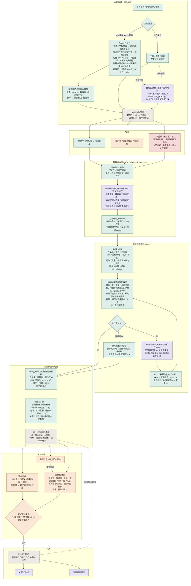

# 需求提取流程图

天工 v2.1.4 当前实现（2026-10-20，含按《Axure 需求提取流程》落地的解析改动）。从材料进来到整理稿交给 AI 分析与测试设计，节点按程序 / 模型调用 / 人工 / 存储四种颜色区分（绿 / 紫 / 橙 / 灰），红色是已排查出的问题点。

## 关键阈值

| 环节 | 阈值 |
|---|---|
| Axure 阅读顺序 | 同一父控件下按 `round(y / 4px)` 分行、行内按 x；子控件坐标沿父链累加 |
| Axure 自校验 | 整页非空白字符多重集 − 去重前全部控件行 = 空（允许 BOM）；差集非空即报缺字 |
| 图片理解 | 短边 ≥ 400px 且 ≥ 20KB 才送 Vision，每包最多 30 张，svg 不送 |
| 分层切单元 | 文件 › 页面；相邻小页打包 ≤ 20000 字，超限页再切并标「第 k 段」 |
| 底稿收录 | 整行子串（去掉行首「1、」「注：1、」「①」再比一次；带数字 / 运算符的按严格规范化比，「=0」不能靠「>0」过关）或按标点切段命中 ≥ 90%（表格行按单元格切段）；短于 4 字须整条等于某条摘录 |
| 程序排除两类 | 小标题（≤ 12 汉字且以冒号结尾等）；无中文且 < 3 个英文单词且不带区间 / 比较符的样例 / 代码。短标签（按钮名 / 表头 / 字段名）交模型判 |
| 需复核 | 模型排除且 ≥ 8 汉字带数字 / 条件词；或理由含「片段 / 上下文 / 不完整」且 ≥ 4 汉字 |
| 补漏 | 待处理全部送模型，每批 ≤ 15000 字，最多 2 轮，之后兜底 |
| 反向核验 | 含数字 / 运算符的条目整句严格命中；其它分段 ≥ 70%；不足 4 字按子串 |
| 版本 | 整理稿历史保留 10 版；逐条改动 rev + 1 |

## 已知问题

红色节点：AI 分析或发起设计时整理稿过期会用设计模型静默重提，新版覆盖当前版（旧版进历史），底稿里人工的收录 / 排除 / 确认判定不会带到新版。修法待定：改为明确提示、模型固定用提取模型、人工判定按单元编号带过去。

同名 `需求提取流程图.html` 可直接用浏览器打开（mermaid 从 CDN 加载），`需求提取流程图.png` 是渲染好的图。
